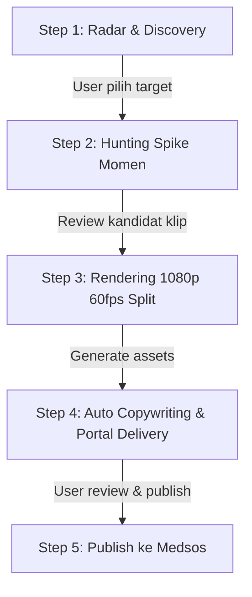

# GTA VI Content Pipeline: Workflow & Formula Operasional

Dokumentasi workflow standar kolaborasi: **User (Director/Reviewer)** + **Antigravity AI (Eksekutor Instabox)**.

---

## 1. Pembagian Peran

| Role | Pemegang | Tanggung Jawab |
|---|---|---|
| **Director / Decider** | **User** | Pilih target stream/video, tentukan angle/hook, review hasil clip, upload ke platform medsos (TikTok/IG/YT Shorts/X). |
| **Operator / Eksekutor** | **AI (Antigravity)** | Eksekusi tools di Instabox (`streams.py`, `moments.py`, `cut.py`, `twitch.py`, Whisper transcription, FFmpeg encoding), validasi rule, generate copywriting (`copywriting.txt`), upload ke portal `/clips/`, kirim preview/status. |

---

## 2. Standar Desain Layout Final (Official Golden Formula)

Format baku yang sudah **FIX, APPROVED, & VERIFIED**:

```
Total Canvas: 1080 x 1920 (9:16 Vertikal) @ 60 FPS
Source Kualitas: Full HD 1080p 60fps Native (299+140)
CRF: 18 (Visually Lossless) | Audio: -14 LUFS Loudness
```

```
+-----------------------------------------------------+ y = 0
| [TOP: FACECAM STREAMER] (Tinggi: 820px)             |
| - Crop Webcam Bottom-Right (w*0.29 : h*0.32)        | [FLOATING LOGO]
| - Upscaling: Lanczos Interpolation + Unsharp Mask   | GTA VI PNG (180px)
| - Hasil: Wajah jernih, tajam, mata & ekspresi jelas | di pojok kanan atas
+-----------------------------------------------------+ y = 820
| [SEAM DIVIDER BAR] (Tinggi: 120px)                  |
| - Top Border: Neon Magenta Pink (0xec4899) 5px      |
| - Bottom Border: Neon Cyan Blue (0x06b6d4) 5px      |
| - Background Box: Deep Dark Slate (0x0a0e17)        |
| - Teks Judul Momen: BEBAS NEUE BOLD (Size: 64px)    |
|   Uppercase, Border hitam 3px, Drop-Shadow 4px      |
|   Posisi Vertikal: y = 820 + (120 - text_h) / 2     |
|   (Center presisi simetris atas & bawah sekat)      |
+-----------------------------------------------------+ y = 940
| [BOTTOM: GAMEPLAY GTA VI] (Tinggi: 980px)           |
| - Crop Gameplay Center (w*0.75 : h*1.0)             |
| - Upscaling: Lanczos + Unsharp Mask                 |
| - BURN-IN SUBTITLES (Area Aman Bawah):              |
|   * Font: Bebas Neue (Size: 56-64px)                |
|   * Warna: Putih (Normal), Kuning/Pink (Penekanan)  |
|   * Stroke: Border hitam 5px, Shadow tebal          |
+-----------------------------------------------------+ y = 1920
```

---

## 3. Aturan Kalibrasi Subtitle, Konteks Cerita & "Perfect Cut Comedy"

1. **Rule Konteks Cerita Wajib (Crucial Context Rewind):**
   - **WAJIB:** Setiap klip/momen apa pun (termasuk kompilasi maupun Perfect Cut) **HARUS selalu dimundurkan 8 - 15 detik** sebelum momen inti atau klimaks terjadi.
   - *Tujuan:* Penonton harus memahami premis awal dan suasana sebelum punchline terjadi (misal: penonton melihat karakter lagi ditinggal AFK dulu, atau streamer lagi tenang fokus dengerin NPC). Jangan pernah memulai klip mendadak pas momen teriak/klimaks sudah terjadi.
   - Durasi total klip optimal: **20 - 38 detik** (Masih sangat ringkas, padat, dan retensi tinggi untuk YouTube Shorts & TikTok).

2. **Rule "Perfect Cut Comedy" (Gong Ending Penutup):**
   - Wajib cari dan pasang ending dengan pola **Perfect Cut**: video dipotong tepat (frame-perfect) di puncak punchline/teriakan/reaksi konyol sebelum sempat mereda, atau tepat sebelum bencana/crash terjadi.
   - *Karakteristik:*
     - Menggabungkan **premis awal tenang (hasil rewind konteks)** -> **eskalasi kaget/panik** -> **terpotong pas puncak kata teriakan** (contoh: *"ANJIR SAMPAI PIPIS GUA TUMPE-TUMPE! [CUT/BLACK]"*).
     - Menimbulkan efek komedi spontan, bikin penonton kaget/ketawa, dan memicu penonton mengulang video (looping views tinggi).

3. **Rule Sinkronisasi Audio-Subtitle (Zero Latency & No Gap Jump):**
   - Timing subtitle harus dikalibrasi langsung dengan analisis waveform audio/mulut streamer, bukan mengandalkan raw subtitle YouTube yang sering delay atau melewatkan kalimat jeda.
   - **Audit Gap Kalimat (Wajib):** Jangan pernah melompati kalimat perantara (seperti jeda gumaman/spoiler/reaksi kecil). Jika ada dialog di antara dua reaksi besar (misal di detik 11-17), kalimat tersebut wajib ditranskripsikan lengkap agar subtitle kalimat berikutnya tidak melompat terlalu cepat sebelum waktunya diucapkan.
   - Gunakan filter strict sync FFmpeg:
     - Video: `fps=60,setpts=PTS-STARTPTS`
     - Audio: `asetpts=PTS-STARTPTS,aresample=async=1000:osr=48000,loudnorm=I=-14:LRA=11:TP=-1.5`

4. **Format Subtitle (Tanpa Emoji/Emotikon):**
   - Teks subtitle bersih tanpa emotikon teks atau emoji (profesional & premium).
   - Beri penekanan emosi murni lewat style warna (Yellow `#00FFFF` dan Pink Magenta `#CC44FF`).

5. **Rule Penambahan Sound Effect (Tasteful SFX Formula):**
   - **Prinsip:** Minimalis, maksimal 2 - 3 titik per klip, tidak boleh menutupi kejelasan suara streamer.
   - **Aset SFX Terstandarisasi:** Tersimpan di `/data/gtavi-claudecode/assets/sfx/`.
     - `delfin.mp3` (`delfin-zensur`): Sensor umpatan/kata kasar tepat di timestamp kata (humor kartun SpongeBob + 100% aman algoritma/Adsense).
     - `vine_boom.mp3`: Bass impact punchline pas kata skakmat / plot twist utama.
     - `faah.mp3`: Reverb echo black screen di ujung Perfect Cut (video cut to black 1.0 detik diiringi sound FAAH).
     - `undertaker.mp3`: Lonceng kematian saat situasi mendadak suram / pasrah kena karma.
     - `violin.mp3`: Biola melankolis saat curhat galau / rugi.
     - `among_us.mp3`: Stinger misteri saat nemu hal ganjil / NPC aneh.
   - **Audio Mixing Filter:**
     ```
     [stream_a][sfx1][sfx2][sfx3]amix=inputs=4:duration=longest:dropout_transition=0,atrim=end=<durasi>,aresample=async=1000:osr=48000,loudnorm=I=-14:LRA=11:TP=-1.5[a]
     ```

6. **Dynamic Visual Reaction (Snap Close-Up + Micro Shake):**
   - **Snap Close-Up (1.5x Tight Facecam):** Saat punchline utama / teriakan / dentuman SFX Boom, facecam snap-cut lompat ke crop fokus wajah streamer (durasi 1.5 - 2 detik), lalu snap balik ke framing normal.
     - *Kalibrasi Tara Arts (Bang Tara Baju Putih)*: Normal `crop=372:230:1534:558`, Close-Up Bang Tara `crop=238:180:1615:578`.
   - **Micro Screen Shake:** Getaran kamera 0.3 detik (`sin(2*PI*t*25)*12`) tepat saat dentuman `vine_boom` meledak, memberi sensasi fisik hentakan bass.
   - **1-Frame White Impact Flash:** Flash tipis (`drawbox=color=white@0.22`) di frame pertama boom untuk punch visual instan.

7. **Pembersihan Overlay Streamer (QR Donate / Watermark Luar):**
   - Gunakan filter `delogo` FFmpeg untuk menghapus box QR Code / donate / overlay sponsor yang mengganggu gameplay.
   - Posisi QR Code Tara Arts: `delogo=x=18:y=32:w=128:h=128` (diterapkan pada stream gameplay sebelum di-scale).
   - Efek: Background game terinterpolasi mulus tanpa bekas kotak putih atau potongan hitam.

---

## 4. Workflow Siklus Kerja (Step-by-Step)



### Step 1: Radar & Discovery (Scan Streamer / Video Hype)
- **Aksi AI**:
  ```bash
  /data/gtavi-claudecode/run.sh streams.py --query "gta 6"
  /data/gtavi-claudecode/run.sh trends.py --query "gta 6" --hours 24
  ```

### Step 2: Hunting Spike Momen (Cari Detik Emas)
- Deteksi momen via chat spike, audio scream/laugh peaks, dan YouTube heatmap.
- Laporkan kandidat timestamp ke user.

### Step 3: Rendering 1080p 60fps Split (Layout Standar Emas)
- Download slice format 1080p native (`299+140`).
- Render dengan layout split 1080x1920 @ 60 FPS:
  - Top Facecam Lanczos + Floating Logo GTA VI PNG.
  - Seam Divider Dual Neon + Bebas Neue Bold Title 62px.
  - Bottom Gameplay + Burn-in Subtitles terkalibrasi.

### Step 4: Auto Copywriting & Compliance Check
- Generate otomatis `copywriting.txt` di folder project.
  - 3 Variasi Judul (Hook story, klik tinggi, emosi).
  - Deskripsi lengkap + timestamps segmen + credit creator wajib.
  - Kumpulan hashtag SEO viral.

### Step 5: Web Portal Delivery (2-Column Studio List)
- Seluruh aset langsung dipublish ke web portal:
  👉 `https://8080-agq23kqdsijuyyvfkrqpswhfru.instabox.tech/clips/`
- **Arsitektur Layout Studio**:
  - **Kolom Kiri (Sticky Player)**: Player video vertikal 9:16, info momen & tag SFX, tombol download 1-klik dengan ukuran file, dan box copywriting lengkap dengan tombol salin instan.
  - **Kolom Kanan (List Klip Vertikal)**: Daftar kartu video terurut dari yang paling baru di paling atas. Dilengkapi filter cepat (*Semua, Tara Arts, Windah Basudara*), badge durasi, ukuran, dan status indikator pemutaran aktif.

---

## 5. Struktur Output Tiap Project Job

```
/data/gtavi-claudecode/jobs/<nama_project>/
├── raw/                      # Potongan slice 1080p 60fps mentah
├── <nama_project>_1080p.mp4  # File video final FIX siap upload
├── subtitles.ass             # Script subtitle timing exact
└── copywriting.txt           # File teks judul, deskripsi, hashtag, credit

# Web Portal Hosting:
/data/html/clips/
├── index.html                # UI Web Portal Player & Downloader
└── files/<nama_project>/
    ├── video.mp4             # Symlink / file video publik
    ├── copywriting.txt       # File teks publik
    ├── thumb.jpg             # Thumbnail aktif di card list (sama dengan thumb_cutout.jpg)
    └── thumb_cutout.jpg      # Thumbnail Art-Director Cutout (1080x1920)
```

---

## 6. Standar Pembuatan Thumbnail (Art-Director Cutout Rule)

Setiap klip yang dipublish ke portal **WAJIB** memiliki thumbnail berstandar Art-Director YouTube Shorts / Reels (`1080 x 1920` @ JPEG q=94) menggunakan engine `/data/gtavi-claudecode/engine/thumb_cutout.py`:

1. **Zero-Clutter Poster Rule:**
   - Dilarang memakai template pasaran, pill header/footer generik, border kotak kaku, atau teks bertele-tele.
   - Fokus penuh pada **visual storytelling** dan **keterbacaan instan di layar HP**.
2. **Auto Peak Expression & Gameplay Extraction:**
   - Cari titik audio RMS tertinggi (`ffmpeg astats`) di rentang 15%–85% durasi untuk menangkap ekspresi wajah streamer paling kuat (kaget, ngamuk, smirk, ngakak).
   - Potong subjek wajah/badan streamer (`y=0..815`, `x=0..860`) menggunakan **`rembg` (`u2net_human_seg`)** dan beri **white sticker outline** (OpenCV `cv2.dilate` 10px) + color/contrast/sharpness boost.
   - Ambil area gameplay (`y=940..1920`) sebagai latar belakang dengan efek `blur + saturate` dan **dual cinematic rim lighting** (Cyan `#06b6d4` vs Magenta `#ec4899`) + diagonal neon energy slash.
3. **Clickbait Cerdas & Typography Hierarchy:**
   - **Hook Utama:** Maksimal **2–4 kata** di area atas (terbaca di feed kecil HP), font `Bebas Neue Bold`, miring dinamis (`-2.5deg`), warna putih `#FFFFFF` + kuning `#FFE600`, stroke hitam tebal (`16–22px`), dan 3D drop-shadow.
   - **Curiosity Hook:** Gunakan panah merah melengkung + 1 badge miring singkat (misal: `MIRIP GAK?!`, `KOK BISA?!`, `KENA MENTAL!`) yang memicu rasa penasaran tanpa menipu isi video.
4. **Integrasi Web Portal & Intro Cover Flash (`0.12s`):**
   - Output disimpan sebagai `thumb_cutout.jpg`, lalu disalin ke `thumb_v1.jpg` dan `thumb.jpg` di `/data/html/clips/files/<id>/` agar langsung tampil di card list dan tab **Cutout** pada `/clips/` (plus `thumb_sm.jpg` 270x480 untuk loading list cepat).
   - **Rule Intro Cover 0.12s (YouTube Shorts / TikTok / Reels Frame Picker):** `thumb_cutout.jpg` wajib di-overlay di awal video pada `t = 0.00–0.12s` (`overlay=0:0:enable='between(t,0,0.12)'`, ~7–8 frame @ 60fps, `-c:a copy`, `-movflags +faststart`). Audio & subtitle tidak bergeser 1ms pun, namun kreator tinggal pilih frame pertama (`0:00`) di YouTube Shorts / TikTok / Reels tanpa upload thumbnail terpisah.

---

## 7. Standar Auto-Watcher Live Stream (`watcher.py` v2 + `context_analyzer.py`)

1. **Rolling 80s Ring Buffer (`-f segment -segment_time 10 -segment_wrap 8`):**
   - Merekam segmen 10 detik terakhir secara kontinu (`-c copy`, ~0% CPU). Saat spike terdeteksi, sistem menunggu 12 detik lalu menggabungkan 5 segmen terakhir (`~35s` SEBELUM spike + `~15s` SESUDAH spike) sehingga premis cerita selalu utuh.
2. **Dual-Signal Quality Gate (Anti Spam Bocil Random):**
   - Lonjakan livechat (`>= 2.8x`) wajib lolos validasi **Audio RMS Peak + dialog Faster-Whisper** di `context_analyzer.py`. Jika streamer diam/monoton, klip otomatis di-skip (`exit code 2`).
3. **Auto-Title, Dynamic Subs & Auto-FX:**
   - Otomatis mengekstrak judul konten nyata dari transkrip puncak ucapan + topik livechat (mendukung LLM opsional via `GROQ_API_KEY` / `GEMINI_API_KEY` di `.env`, atau fallback lokal cerdas), memberi warna subtitle dinamis (`Default`/`Highlight`/`Magenta`), serta memasang **Snap Zoom 1.5x**, **Micro Screen Shake**, **White Impact Flash**, **Auto Dolphin Censor**, **Vine Boom**, **FAAH Perfect Cut**, dan **Art-Director Cutout Thumbnail**.
